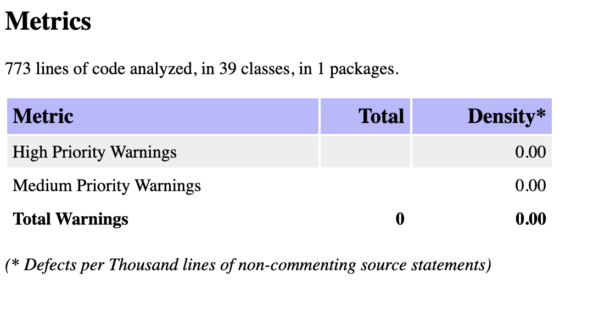

# infosec-lab1

Журнал инцидентов информационной безопасности

Лабораторная работа № 1: защищённый REST API с интеграцией в CI/CD.
**Kotlin + Spring Boot.** Пользователь регистрирует инциденты, указывает категорию и
критичность, берёт их в работу и закрывает. Каждому доступны только собственные записи.

**Автор:** Гаврилович Вероника Вячеславовна, Р3431.
**Репозиторий:** [veronlkkkaa/infosec-lab1](https://github.com/veronlkkkaa/infosec-lab1).

**Версия:** журнал инцидентов, коммит [`70880fa`](https://github.com/veronlkkkaa/infosec-lab1/commit/70880fa1da8e91a77ccb808b54d23ee018821621).
[GitHub Actions — запуск № 1](https://github.com/veronlkkkaa/infosec-lab1/actions/runs/40358417953).

## Стек

Kotlin 2.4.21, Spring Boot 4.1.2, Spring MVC, Spring Security, Nimbus JWT,
Spring JDBC / JdbcTemplate, файловая H2. JDK 21, Gradle Wrapper 8.14.5.
Пароли: BCrypt, cost 12. JSON: Jackson 3. Тесты: JUnit / MockMvc.
SAST: SpotBugs 4.10.4 + Find Security Bugs 1.14.0. SCA: OWASP Dependency-Check 12.2.2.

Версии инструментов заданы в `build.gradle.kts`; версии Spring-зависимостей управляются BOM.
Gradle lock-файла пока нет.

## Архитектура

- ApiController: маршруты, получение владельца из JWT, формирование и экранирование ответов.
- IncidentService: создание, проверка владельца, переходы статуса и границы транзакций.
- IncidentRepository: параметризованный SQL, выборка своих записей, условное изменение статуса.
- IncidentApiModels: входные и выходные DTO; IncidentModels: внутренние модели и типы ошибок.
- AuthService / UserRepository: проверка пароля, выдача JWT и работа с пользователями.
- SecurityConfig / RequestGuardFilter / JsonConfig: JWT, лимиты и строгий JSON.
- ApiExceptionHandler: перевод ошибок сервиса в HTTP и единый JSON без паролей и SQL-параметров.

Таблица app_user хранит id, username, password_hash.
Таблица incident: id, owner_id, title, description, category, severity, status,
created_at, updated_at. Есть внешний ключ владельца, индекс (owner_id, id),
NOT NULL и CHECK для перечислений. Поля времени и начальный статус задаёт сервер.

## API

| Метод | Вход | Успех |
|---|---|---|
| POST /auth/login | username, password | 200: access_token, token_type, expires_in |
| GET /api/data | нет | 200: items, последние 100 своих инцидентов |
| POST /api/incidents | title, description, category, severity | 201: инцидент со статусом NEW |
| PATCH /api/incidents/{id}/status | status | 200: обновлённый инцидент |

Первые три метода покрывают обязательный контракт работы; PATCH добавляет обработку инцидента.
Все `/api/*` требуют `Authorization: Bearer <token>`. Запросы с JSON должны содержать
`Content-Type: application/json`. Базовый URL при локальном запуске — `http://127.0.0.1:8080`.

- title: непустой текст до 120 UTF-16 единиц; description: непустой текст до 2000.
- category: PHISHING, MALWARE, UNAUTHORIZED_ACCESS, DATA_LEAK, OTHER.
- severity: LOW, MEDIUM, HIGH, CRITICAL.
- status: NEW → IN_PROGRESS → CLOSED. Пропуск, обратный переход и повторное открытие запрещены.
- Повтор текущего статуса разрешён и не меняет updated_at.

Ошибки: 400 invalid_request; 401 unauthorized; 403 forbidden; 404 not_found;
409 invalid_status_transition / incident_changed; 413 request_too_large;
415 json_required; 429 too_many_requests. Формат: {"error":"код"}.

### POST /auth/login — получить токен

Тело запроса (значение пароля ниже — заполнитель, а не готовая учётная запись):

```json
{"username":"alice","password":"<пароль, заданный при запуске>"}
```

Для вызова без записи пароля в историю команд используется готовый скрипт:

```bash
TOKEN="$(./scripts/login.sh alice)"
```

Он скрыто запрашивает пароль, формирует JSON через `jq`, отправляет `POST /auth/login`
и сохраняет только `access_token` в переменной терминала. Пароль не выводится на экран.
Формат успешного ответа — `200 OK`:

```json
{"access_token":"<подписанный JWT>","token_type":"Bearer","expires_in":900}
```

Неверный пароль или неизвестное имя дают `401` и `{"error":"unauthorized"}`.
Публичной регистрации нет: первоначальные аккаунты создаются при старте приложения.

### Вход и регистрация события

```bash
curl -i http://127.0.0.1:8080/api/data
TOKEN="$(./scripts/login.sh alice)"
INCIDENT_ID="$(curl --fail-with-body -sS http://127.0.0.1:8080/api/incidents \
  -H "Authorization: Bearer $TOKEN" -H 'Content-Type: application/json' \
  --data '{"title":"Подозрительное письмо","description":"Неожиданное вложение от неизвестного отправителя","category":"PHISHING","severity":"HIGH"}' \
  | jq -er '.id')"
curl -i http://127.0.0.1:8080/api/data -H "Authorization: Bearer $TOKEN"
```

Ожидается: 401 без токена; после входа 201 при создании и 200 при чтении. Статус новой записи - NEW.
login.sh запрашивает пароль скрыто. Полный JWT и пароли не должны попадать на скриншоты.

Пример структуры ответа на создание (ID и даты приведены для иллюстрации):

```json
{
  "id": 1,
  "title": "Подозрительное письмо",
  "description": "Неожиданное вложение от неизвестного отправителя",
  "category": "PHISHING",
  "severity": "HIGH",
  "status": "NEW",
  "created_at": "2026-10-26T12:00:00Z",
  "updated_at": "2026-10-26T12:00:00Z"
}
```

`GET /api/data` возвращает `{"items":[...]}` с такими же объектами; без записей —
`{"items":[]}`. Порядок: новые ID первыми, максимум 100 собственных инцидентов.
`PATCH` возвращает тот же объект с новым статусом и временем изменения.

### Обработка и закрытие

```bash
curl -i -X PATCH "http://127.0.0.1:8080/api/incidents/$INCIDENT_ID/status" \
  -H "Authorization: Bearer $TOKEN" -H 'Content-Type: application/json' \
  --data '{"status":"IN_PROGRESS"}'
curl -i -X PATCH "http://127.0.0.1:8080/api/incidents/$INCIDENT_ID/status" \
  -H "Authorization: Bearer $TOKEN" -H 'Content-Type: application/json' \
  --data '{"status":"CLOSED"}'
```

Ожидается 200 для обоих переходов. Попытка вернуть CLOSED в IN_PROGRESS должна дать 409.
После перезапуска с той же базой запись и её статус должны сохраниться; токен при смене ключа нужно получить заново.

### Проверки безопасности

```bash
BOB_TOKEN="$(./scripts/login.sh bob)"
curl -i http://127.0.0.1:8080/api/data -H "Authorization: Bearer $BOB_TOKEN"
curl -i -X PATCH "http://127.0.0.1:8080/api/incidents/$INCIDENT_ID/status" \
  -H "Authorization: Bearer $BOB_TOKEN" -H 'Content-Type: application/json' \
  --data '{"status":"IN_PROGRESS"}'
curl -i http://127.0.0.1:8080/api/incidents \
  -H "Authorization: Bearer $TOKEN" -H 'Content-Type: application/json' \
  --data '{"title":"XSS demo","description":"<script>alert(1)</script>","category":"OTHER","severity":"LOW"}'
printf '%s' "alice' OR 1=1 --" | jq -Rs '{username: ., password: "wrong-password"}' | \
  curl -i http://127.0.0.1:8080/auth/login -H 'Content-Type: application/json' --data-binary @-
unset TOKEN BOB_TOKEN
```

Ожидается отсутствие инцидента alice у bob, 404 при изменении чужой записи,
экранированный description и 401 при SQLi в логине. Дополнительно проверяются
неверный JWT, owner_id в JSON, severity=0, тело больше 16 КиБ и лимит входа.

## Реализованные меры защиты

### SQL-инъекции (SQLi)

В `UserRepository` и `IncidentRepository` пользовательские значения передаются отдельно от
SQL через параметры `?` в `JdbcTemplate` или через `PreparedStatement.setString/setLong`.
Например, поиск пользователя выполняется как `WHERE username = ?`, а изменение инцидента —
как `WHERE id = ? AND owner_id = ? AND status = ?`. Текст запроса фиксирован; пользовательский
ввод не подставляется конкатенацией. Строка `alice' OR 1=1 --` остаётся значением имени,
а не частью SQL-условия. Валидация дополняет параметризацию, но не заменяет её.

### Межсайтовый скриптинг (XSS)

Исходные `title` и `description` сохраняются в БД как текст. При формировании ответа
`ApiController.toResponse()` вызывает `HtmlUtils.htmlEscape(..., "UTF-8")` для обоих полей.
Этот общий метод используется при создании, получении списка и изменении статуса:
сохранённая строка `<script>alert(1)</script>` выдаётся как
`&lt;script&gt;alert(1)&lt;/script&gt;`. Ответы имеют `Content-Type: application/json`.

Дополнительные ограничения: `X-Content-Type-Options: nosniff`,
`Content-Security-Policy: default-src 'none'; frame-ancestors 'none'` и запрет фреймов.
HTML-экранирование относится к HTML-контексту и не является универсальной защитой для
JavaScript, CSS или URL. Будущий интерфейс должен выводить текст безопасно, например через
`textContent`, и не вставлять декодированное содержимое в `innerHTML`.

### Пароли и аутентификация

1. При первоначальном создании пользователя `BootstrapUsers` проверяет длину пароля:
   минимум 15 символов, максимум 72 байта UTF-8. Ограничение в байтах предотвращает
   неоднозначность из-за ограничения BCrypt. Начальные пароли вводит пользователь;
   они не зашиты в исходники.
2. `BCryptPasswordEncoder(12)` создаёт соль и хэш. В БД сохраняется только `password_hash`;
   строка BCrypt содержит алгоритм, стоимость, соль и результат хэширования. При входе
   пароль проверяется через `matches`, а не расшифровывается.
3. Неизвестный пользователь и неверный пароль получают одинаковый ответ `401 unauthorized`.
   Для неизвестного пользователя выполняется проверка с фиктивным BCrypt-хэшем,
   чтобы уменьшить различие во времени ответа; это не обещает идеально постоянного времени.
4. После успешного входа `AuthService` выпускает JWT с подписью HS256 на 900 секунд.
   `sub` содержит ID пользователя, `iss` — `lab1-secure-api`, `aud` — `lab1-client`;
   также задаются `iat`, `nbf`, `exp`. Пароль и хэш в токен не включаются.
5. `NimbusJwtDecoder` принимает HS256, проверяет подпись и издателя; дополнительные
   валидаторы проверяют аудиторию, обязательные временные поля, срок действия и наличие
   пользователя в БД. Просроченный токен, неверная подпись или claims дают `401`.
   Ключ передаётся через `JWT_SECRET_BASE64`; он должен содержать минимум 32 случайных байта.

JWT подписан, но не зашифрован: его payload доступен владельцу токена. Для передачи
паролей и токенов вне localhost необходим HTTPS. В приложении нет refresh token,
MFA и индивидуального отзыва токенов; смена ключа делает ранее выпущенные JWT недействительными.

### Авторизация и защита от доступа к чужим данным

`POST /auth/login` доступен без токена; `/api/**` требует аутентификации, остальные маршруты
запрещены. Приложение не использует HTTP Basic, форму входа, cookie для аутентификации
или серверную сессию. JWT передаётся явно в `Authorization: Bearer ...`.

Владелец берётся из проверенного `sub`, а не из тела запроса. Выборка и обновление в БД
ограничены `owner_id`. При создании поля `owner_id`, `id`, даты и статус от клиента не
принимаются. Чужой и отсутствующий ID возвращают одинаковый `404`, чтобы не раскрывать
наличие чужих записей. Допустимы только переходы `NEW → IN_PROGRESS → CLOSED`.
Изменение транзакционно, а SQL сравнивает прежний статус: конкурентное изменение даёт
`409 incident_changed` вместо незаметной перезаписи.

### Валидация, ограничения и ошибки

- Bean Validation и сервис проверяют обязательность текста, длины, NUL и корректность Unicode.
- Jackson отклоняет неизвестные поля и лишний JSON после основного объекта, не приводит
  числа/boolean к строкам и не принимает числовые индексы вместо enum.
- Тело запроса ограничено 16 КиБ, включая chunked-запросы без известного Content-Length.
- Вход ограничен 10 попытками за минуту с одного IP; превышение даёт `429` и `Retry-After: 60`.
  Счётчик локален процессу, использует `remoteAddr` и не заменяет общий лимит на reverse proxy.
- Ошибки возвращаются как `{"error":"код"}` без stack trace, SQL и значений параметров.
  `LoginRequest` не является data class, поэтому автогенерируемый `toString()` с паролем отсутствует.
- Spring Security задаёт защитные HTTP-заголовки; кэширование защищённых ответов запрещено.
- CSRF отключён для stateless API с явным Bearer-заголовком. Если добавить cookie-аутентификацию,
  эту настройку нужно пересмотреть.

Это учебный сервис: нет командного доступа, полного поиска по истории и журнала всех
изменений. Описанные меры не означают полного покрытия OWASP Top 10 или промышленной готовности.

## CI и проверка

.github/workflows/ci.yml содержит api-tests, sast и sca; запуск при push, pull_request и вручную.
SAST анализирует production-байткод категории SECURITY. Три узких исключения документированы
в config/spotbugs/reviewed-exclusions.xml: stateless CSRF, инвентаризация четырёх известных
методов контроллера и чтение длины Authorization. XSS_SERVLET не исключён.

SCA проверяет прямые и транзитивные runtime-зависимости через стандартный NVD REST API.
Версия анализатора закреплена на **12.2.2**: в 13.0.0 подтверждена
[регрессия анонимного доступа к NVD](https://github.com/dependency-check/DependencyCheck/issues/8715).
Внутренний конфигурационный файл 13.0.0 задаёт пустой ключ даже при отсутствии настройки
в Gradle. Поэтому одной фильтрации пустой переменной окружения недостаточно.
В исходниках 12.2.2 этого пустого значения по умолчанию нет; опубликованный плагин
сохраняет используемые в проекте Gradle Property-настройки.
Переход версии проверен чтением исходников и конфигурации; новый SCA ещё не запускался.
Неработающий URL feed удалён: Dependency-Check использует штатный API по
[официальной документации](https://dependency-check.github.io/DependencyCheck/dependency-check-gradle/configuration.html).
Без ключа используется анонимный доступ с более длительной паузой между запросами;
лимит времени job увеличен до 60 минут для первоначальной загрузки базы.
Необязательный `NVD_API_KEY` передаётся из окружения; в Actions — из одноимённого repository secret.
Если ключ не задан, проверка работает в анонимном режиме. Значение ключа в Git не сохраняется.
OSS Index выключен. Тестовый/build classpath не охвачен.
CVSS ≥ 7 и ошибки инструмента блокируют job; отдельный контроль SHA-256 требует все рабочие JAR
в JSON-отчёте. Отчёты сохраняются через if: always(). Actions закреплены по SHA.

### Результаты GitHub Actions

Источник — [запуск № 1 от 26.10.2026](https://github.com/veronlkkkaa/infosec-lab1/actions/runs/40358417953),
коммит `70880fa1da8e91a77ccb808b54d23ee018821621`, ветка `main`, событие `push`.

| Проверка | Результат | Отчёт |
|---|---|---|
| API / security tests | 26 тестов, 0 ошибок, 0 пропусков | [Job api-tests](https://github.com/veronlkkkaa/infosec-lab1/actions/runs/40358417953/job/121697005906), артефакт `api-tests` |
| SAST | Job успешен; HTML: 39 классов, 0 предупреждений | [Job sast](https://github.com/veronlkkkaa/infosec-lab1/actions/runs/40358417953/job/121697006320), артефакт `spotbugs-sast` |
| SCA | Ошибка загрузки NVD: HTTP 404; отчёта нет | [Job sca](https://github.com/veronlkkkaa/infosec-lab1/actions/runs/40358417953/job/121697006297) |

В HTML-отчёте SAST указаны **773 строки кода, 39 классов, 0 предупреждений** при
выбранном фильтре SECURITY и документированных исключениях. При этом XML того же
артефакта содержит `total_classes="0"`, хотя перечисляет 39 входных class-файлов.
Статистика HTML и XML расходится; причина пока не установлена. Нулевое число
предупреждений не доказывает отсутствие всех возможных уязвимостей.

Отчёт SAST из этого запуска сохранён в репозитории: [HTML](docs/evidence/ci-40358417953/main.html),
[XML](docs/evidence/ci-40358417953/main.xml). Артефакты GitHub Actions хранятся 30 дней.
Чтобы открыть оригинал: Actions → Kotlin API security CI → first commit #1 → Artifacts →
`spotbugs-sast` или `dependency-check-sca`; скачать ZIP и открыть HTML-отчёт.

### Скриншоты отчётов SAST/SCA

Готовый SAST можно открыть локально: [main.html](docs/evidence/ci-40358417953/main.html),
либо скачать [исходный ZIP](docs/evidence/ci-40358417953/spotbugs-sast.zip).
Причина отсутствия отчёта SCA сохранена в [sca-error.txt](docs/evidence/ci-40358417953/sca-error.txt):
источник NVD вернул HTTP 404 при загрузке `nvdcve-2.0-modified.json.gz`.
В текущей конфигурации этот URL заменён штатным NVD API. Read-only запрос с
`resultsPerPage=1` вернул HTTP 200; это проверка доступности API, а не успешный запуск SCA.
Повторный анализ после исправления ещё не запускался.

Скриншот SAST предоставлен автором и сохранён без изменений. Его показатели совпадают
с HTML-отчётом запуска № 1: 773 строки, 39 классов, 0 предупреждений.



**Осталось добавить:**

- `docs/screenshots/sca-report.png` — сводку HTML из артефакта `dependency-check-sca`
  после успешного анализа с исправленным источником данных.
- `docs/screenshots/ci-summary.png` — страницу соответствующего запуска Actions с коммитом
  и итоговыми статусами jobs.

Скриншот SAST относится к запуску № 1 и коммиту `70880fa`; для будущего отчёта SCA
нужно указать ссылку на новый запуск и его коммит. Старые отчёты из
`docs/evidence/notes-2026-10-25/` относятся к прежнему приложению заметок и не подтверждают
текущий журнал инцидентов. Текущий pipeline завершился с ошибкой SCA; успешного полного прогона пока нет.
